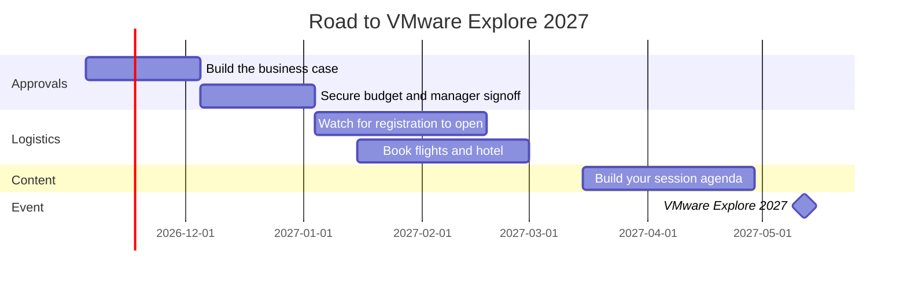

# VMware Explore 2027 Moves to Spring: May 10–13 at Resorts World Las Vegas

Mark your calendars. VMware Explore 2027 is officially on the books, and it comes with two big changes: **new spring dates** and a **brand-new venue**.

Instead of the late-summer timing many of us have built our planning cycles around, Explore 2027 lands in May. The show is also moving to Resorts World on the north end of the Las Vegas Strip.

## The details

| | |
|---|---|
| **Event** | VMware Explore 2027 |
| **Dates** | Monday, May 10 – Thursday, May 13, 2027 |
| **Venue** | Resorts World, Las Vegas |
| **Organizer** | Broadcom |
| **More info** | [vmware.com/explore/us](https://www.vmware.com/explore/us) |
| **Add to calendar** | [Save the date](https://www.addevent.com/event/q3p0q4z2gt4j) |

Same top-tier technical content, new season, new home.

## Why the spring move matters

Shifting Explore from late summer to May changes the planning math for practitioners, partners, and customers alike:

- **Shorter runway.** That puts the event roughly six months out from today, so travel, budget, and approval conversations need to start now rather than in the spring.
- **Different budget cycle.** For many organizations, a May event falls into a different fiscal quarter than a late-summer one. If your training or travel budget is tied to a specific quarter, confirm where Explore 2027 lands.
- **Earlier content cycle.** Expect the session catalog, call for papers, and registration milestones to shift earlier as well. Keep an eye on the official Explore site for exact dates.
- **Fresh venue logistics.** A new venue means new walking routes, new hotel blocks, and new places to grab coffee between sessions. Plan accordingly.

## Suggested planning timeline

This is a suggested timeline, not an official one. Adjust it once Broadcom publishes the registration and session catalog dates.

## Pro tips for Explore 2027

- **Start the business case now.** Tie your attendance to concrete outcomes: VCF roadmap clarity, hands-on labs, certification prep, and peer conversations you cannot get from a webinar.
- **Book lodging early.** New venue plus Las Vegas in May means hotel inventory near Resorts World could tighten fast once registration opens.
- **Plan your sessions around problems, not product names.** Bring two or three real challenges from your environment (lifecycle, multi-tenancy, automation, private AI) and hunt for sessions that address them.
- **Block time for the hallway track.** Some of the most valuable conversations at Explore happen between sessions with peers, vExperts, and the engineers who build the products.
- **Bring comfortable shoes.** This is Vegas. You will walk more than you think.

## Closing thought

Explore has always been the place where the VMware community gets the clearest look at where the platform is heading. Moving to May gives everyone an earlier read on the roadmap and a fresh setting to connect in. Lock in the dates, start the approval conversation, and I hope to see you at Resorts World.

## References

- [VMware Explore 2027 – Save the Date (AddEvent)](https://www.addevent.com/event/q3p0q4z2gt4j)
- [VMware Explore US – Official Site](https://www.vmware.com/explore/us)
